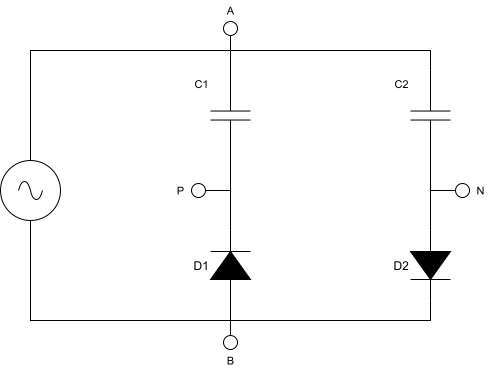

## Diode‑Plug Energy Extraction from a Resonant AC Source

> **Simulator cross-reference:** See [model coverage and sign-convention notes](MODEL_COVERAGE.md).
> The original exploratory text below contains susceptance/complex-power and
> equivalent-resistance sign conventions that do not agree with `Y = I/V` using
> passive input current. The Rust simulator reports its own explicit convention
> and does not predict sustained negative input power from a passive steady-state load.
> The simulator's optional externally powered AC return equivalent can produce
> negative **combined** fundamental conductance; it separately reports the
> passive plug contribution and the return-path energy source.

> **Finite-cycle precharge experiment:** The simulator's Experiments → Energy return to mains view can
> start with externally precharged C1/C2 and report signed **cycle-average**
> source/port power without first settling the circuit. Negative power during
> discharge is paid for by a decrease in stored energy; the display includes
> load, losses and an energy-balance residual. This transient result is not a
> sustained negative steady-state input power or a periodic operating-point G.

This section describes the **diode‑plug** topology and derives the main formulae for voltages, currents, energies, and powers, using standard circuit theory.

### Circuit Topology

We consider an AC (or resonant) source \(v_s(t)\) with terminals \(A\) and \(B\), feeding two rectifying branches that create a split DC bus:

- Branch 1 (P-clamp rail): \(A \rightarrow C_1 \rightarrow P\), with diode **D₁** clamping **P** to **B** (conducts **B → P** when \(v_P\) becomes sufficiently negative).
- Branch 2 (N-clamp rail): \(A \rightarrow C_2 \rightarrow N\), with diode **D₂** clamping **N** to **B** (conducts **N → B** when \(v_N\) becomes sufficiently positive).

Node **B** is the electrical reference (0 V).
All node voltages \(v_A, v_P, v_N\) are measured with respect to node **B** unless stated otherwise.

A load \(R_L\) is connected between nodes \(P\) and \(N\).

Node voltages (with \(v_B(t)=0\)):

\(v_s(t)\) is the ideal source voltage.  
\(v_A(t)\) is the driven node voltage after source impedance (so in general \(v_A(t)\neq v_s(t)\)).  
\(v_P(t),\ v_N(t)\) are the floating clamp-node voltages.

Capacitor voltages:

\(
v_{C_1}(t) = v_A(t) - v_P(t), \quad
v_{C_2}(t) = v_A(t) - v_N(t).
\)

Capacitor currents:

\(
i_{C_1}(t) = C_1 \frac{\mathrm{d}v_{C_1}}{\mathrm{d}t}, \quad
i_{C_2}(t) = C_2 \frac{\mathrm{d}v_{C_2}}{\mathrm{d}t}.
\)

Energies stored in the capacitors:

\(
E_{C_1}(t) = \frac{1}{2} C_1 v_{C_1}^2(t), \quad
E_{C_2}(t) = \frac{1}{2} C_2 v_{C_2}^2(t).
\)

For a resonant or sinusoidal source we assume:

\(
v_s(t) = \hat{V}_s \sin(\omega t), \quad
\omega = 2\pi f, \quad
T = \frac{2\pi}{\omega}.
\)

### Diode Conduction Conditions

Diode reference voltages (with node B as reference):

\(
v_{D_1}(t) = v_B(t) - v_P(t) = -\,v_P(t), \quad
v_{D_2}(t) = v_N(t) - v_B(t) = v_N(t).
\)

Conduction conditions (piecewise-linear diode model with \(V_f\) and \(R_d\)):

- **D₁ (B → P clamp)**  
  - If \( v_P(t) < -V_f \): D₁ ON  
    \(
    i_{D_1}(t)=\max\!\left(0,\frac{-v_P(t)-V_f}{R_d}\right)
    \)
    During conduction, \(v_P(t)\) is limited near \(-V_f\) (softly, due to \(R_d\)).  
  - If \( v_P(t) \ge -V_f \): D₁ OFF, \( i_{D_1}(t)=0 \)

- **D₂ (N → B clamp)**  
  - If \( v_N(t) > +V_f \): D₂ ON  
    \(
    i_{D_2}(t)=\max\!\left(0,\frac{v_N(t)-V_f}{R_d}\right)
    \)
    During conduction, \(v_N(t)\) is limited near \(+V_f\) (softly, due to \(R_d\)).  
  - If \( v_N(t) \le +V_f \): D₂ OFF, \( i_{D_2}(t)=0 \)

Whenever a diode turns ON, charge is redistributed between the corresponding capacitor,
the driven node A, and the reference node B, depending on the instantaneous circuit state.

### Steady‑State Capacitor Voltages (No Load)

With no load connected (\(R_L \to \infty\)) and under idealized conditions (small source impedance and negligible losses), each capacitor charges approximately to the source peak magnitude (half-wave rectification):

\(
V_{P,\text{ss}} \approx \hat{V}_s,\quad
V_{N,\text{ss}} \approx \hat{V}_s.
\)

Steady‑state energies:

\(
E_{C_1,\text{ss}} \approx \frac{1}{2} C_1 \hat{V}_s^2, \quad
E_{C_2,\text{ss}} \approx \frac{1}{2} C_2 \hat{V}_s^2.
\)

Total:

\(
E_{\text{stored}} \approx \frac{1}{2} (C_1 + C_2) \hat{V}_s^2.
\)

If we define a total capacitance \(C_s = C_1 + C_2\), then:

\(
E_{\text{stored}} \approx \frac{1}{2} C_s \hat{V}_s^2.
\)

Thus, splitting into two capacitors does **not** change the total stored energy; it only redistributes it between nodes \(P\) and \(N\) .

### Load Voltage and Power

With a load \(R_L\) connected between \(P\) and \(N\), the instantaneous load voltage and current are:

\(
v_L(t) = v_P(t) - v_N(t), \quad
i_L(t) = \frac{v_L(t)}{R_L}.
\)

Instantaneous load power:

\(
p_L(t) = v_L(t)\,i_L(t) = \frac{v_L^2(t)}{R_L}.
\)

Average (real) power over one period \(T\):

\(
P_L = \frac{1}{T}\int_0^T p_L(t)\,\mathrm{d}t
    = \frac{1}{T R_L} \int_0^T v_L^2(t)\,\mathrm{d}t.
\)

### Single‑Pulse Discharge of One Capacitor

If capacitor \(C_1\) is pre‑charged to \(V_{P0}\) and then discharged into \(R_L\) (with \(N\) held at 0 V for the duration of the pulse), the classic RC discharge equations are:

\(
v_P(t) = V_{P0} e^{-t/(R_L C_1)}, \quad
i_L(t) = \frac{V_{P0}}{R_L} e^{-t/(R_L C_1)}.
\)

Instantaneous power:

\(
p_L(t) = \frac{V_{P0}^2}{R_L} e^{-2t/(R_L C_1)}.
\)

Energy delivered to the load in this pulse:

The energy dissipated in the resistive discharge path is obtained by integrating
the instantaneous resistive power during the exponential decay:

- Instantaneous resistive power:
  \( p_L(t) = \dfrac{v_P^2(t)}{R_L} \)

- Voltage decay on node P:
  \( v_P(t) = V_{P0}\, e^{-t/(R_L C_1)} \)

- Time-integrated dissipated energy:
  \( E_L = \int_0^\infty p_L(t)\,\mathrm{d}t \)

Substituting the decay expression yields:

\( E_L = \dfrac{V_{P0}^2}{R_L} \int_0^\infty e^{-2t/(R_L C_1)}\,\mathrm{d}t \)

Evaluating the integral gives:

\( E_L = \dfrac{V_{P0}^2}{R_L} \cdot \dfrac{R_L C_1}{2}
       = \tfrac{1}{2} C_1 V_{P0}^2 \)

This equals the initial stored energy:

\(
E_L = \Delta E_{C_1}
     = \frac{1}{2} C_1 V_{P0}^2.
\)

If such pulses occur at repetition frequency \(f_p\), the average power contributed by capacitor \(C_1\) is:

\(
P_{L,1} = f_p \cdot \frac{1}{2} C_1 V_{P0}^2.
\)

For symmetric operation with \(C_1 = C_2 = C_s/2\) and \(V_{P0} = V_{N0} = \hat{V}_s\) (and both capacitors discharged alternately at the same \(f_p\)):

\(
P_{L,\text{total}} 
= f_p \cdot \frac{1}{2} C_s \hat{V}_s^2.
\)

### Energy Balance and Equivalent Load Seen by the Source

Let

- \(P_{\text{in}}\): average real power drawn from the AC source,
- \(P_L\): average power delivered to the load,
- \(P_{\text{loss}}\): total losses (conduction, ESR, switching, etc.).

Energy conservation implies:

\(
P_{\text{in}} = P_L + P_{\text{loss}}.
\)

From the source’s perspective, the diode‑plug plus load can be modeled as an equivalent resistance \(R_{\text{eq}}\) (at the fundamental frequency) such that:

\(
P_{\text{in}} \approx \frac{V_{\text{rms}}^2}{R_{\text{eq}}},
\)

where \(V_{\text{rms}}\) is the RMS value of \(v_A(t)\) at the diode-plug connection (terminals A-B).

If the AC source is actually the output of a resonant tank with inductance \(L\) and effective tank capacitance \(C_{\text{tank}}\), the resonant frequency and loaded \(Q\) are approximately:

\(
\omega_0 = \frac{1}{\sqrt{L C_{\text{tank}}}}, \quad
Q \approx \frac{\omega_0 L}{R_{\text{loss}} + R_{\text{eq}}}.
\)

Here \(R_{\text{eq}}\) denotes the real part of the diode‑plug’s series‑equivalent impedance at ω0, derived from the admittance \(Y_{\text{eq}} = G + jB\).

By designing the diode‑plug such that

\(
\Delta E_{\text{extract per cycle}} \ll E_{\text{tank}},
\)

the disturbance of the resonant waveform is minimized and the plug behaves as a weak, quasi‑constant load on the resonant system.

---

### Apparent Negative Resistance and Equivalent Admittance of the Diode‑Plug

When the diode‑plug is connected to a resonant AC node and the system is observed from the **AC side**, measurements may show that the plug behaves as if it had an **effective negative resistance**. This section explains that behavior and shows how to model the plug as an **equivalent admittance** \(
Y_{\text{eq}} = G + jB\) at the fundamental frequency of the AC node.

### Definition of equivalent admittance at the fundamental

Let the voltage and current at the AC node (between terminals A and B) be:

- Instantaneous:
  \(
  v_s(t),\quad i_s(t)
  \)
- Fundamental phasors (RMS at \(\omega_0\):
  \(
  V_1,\quad I_1
  \)
obtained in steady state over an integer number of fundamental periods, for example by applying an FFT to \(v_s(t)\) and \(i_s(t)\) and extracting the complex Fourier coefficients at \(\omega_0\).

The equivalent admittance of the diode‑plug, referred to the fundamental, is defined as:
\(
Y_{\text{eq}} = \frac{I_1}{V_1} = G + jB
\)
where:

- \(G\) is the **conductance** (real part),
- \(B\) is the **susceptance** (imaginary part).

The corresponding equivalent impedance is:
\(
Z_{\text{eq}} = \frac{1}{Y_{\text{eq}}} = R_{\text{eq}} + jX_{\text{eq}}
\)
with \(R_{\text{eq}} = 1/G\) if \(G\neq 0\).

### Relation to measured active and reactive power

The complex power associated with the fundamental components only is defined as:
\(
S_1 = P_1 + jQ_1 = V_1 I_1^*
\)

where \(P_1\) and \(Q_1\) are the active and reactive power contributions of the fundamental; higher harmonics are neglected in this equivalent‑admittance model.

Then subsequent equations:
\(
P_1 = \Re\{V_1 I_1^*\} = |V_1|^2 G,
\qquad
Q_1 = \Im\{V_1 I_1^*\} = |V_1|^2 B
\)

So the equivalent conductance and susceptance can be obtained directly from measured fundamental power:

\(
G = \frac{P_1}{|V_1|^2},\qquad
B = \frac{Q_1}{|V_1|^2}
\)

If a power analyzer reports active power \(P\) and reactive power \(Q\) already filtered to the fundamental, then \(P_1 \approx P\) and \(Q_1 \approx Q\).

- **Positive \(G\)** → plug behaves as a normal load (positive resistance).
- **Negative \(G\)** → plug behaves as an *active source* at the fundamental (negative resistance).
- **Positive \(B\)** → plug appears inductive.
- **Negative \(B\)** → plug appears capacitive.

In many practical diode‑plug configurations, the plug appears as **negative \(G\)** and **negative \(B\)**: an active subsystem with capacitive character.

This apparent negative conductance arises because the diode‑plug can return previously stored energy to the AC node during parts of the cycle; it does not imply any violation of energy conservation.

### Mechanism leading to negative conductance

The diode‑plug is a **strongly nonlinear, time‑varying** element:

1. **Charging intervals**  
   During parts of the AC cycle, the diodes conduct and the capacitors \(C_1\), \(C_2\) absorb energy:
   \(
   p(t) = v_s(t)i_s(t) > 0
   \)
   Energy flows from the AC node into the plug.

2. **Discharging / return intervals**  
   At other times—depending on downstream circuitry, stored voltages, and switching—the capacitors can **return energy** toward the AC node (e.g., by driving current in the opposite direction to the instantaneous source voltage). In those intervals:
   \(
   p(t) = v_s(t)i_s(t) < 0
   \)

3. **Net effect over a period**  
   If, over one fundamental period \(T\),
   \(
   P_1 = \frac{1}{T}\int_0^T v_s(t)\,i_s(t)\,dt < 0
   \)
   then, at the fundamental, the plug is **delivering net real energy** to the AC node rather than consuming it.

This is mathematically equivalent to a negative conductance:
\(
G = \frac{P_1}{|V_1|^2} < 0,\qquad R_{\text{eq}} = \frac{1}{G} < 0
\)

The origin of that energy is the **stored energy** in the capacitors and any connected downstream circuitry (batteries, DC bus, etc.). From the AC node perspective, such a subsystem is indistinguishable from an active source while it is discharging.

### Susceptance and the role of added capacitance

The diode‑plug also exchanges significant **reactive energy** with the resonant tank. The instantaneous reactive energy in its capacitors is:

The instantaneous energy stored in the capacitors is determined by their terminal voltages:

- Capacitor **C₁** (between A and P):  
  \( E_{C_1}(t) = \tfrac{1}{2} C_1 \bigl(v_A(t) - v_P(t)\bigr)^2 \)

- Capacitor **C₂** (between A and N):  
  \( E_{C_2}(t) = \tfrac{1}{2} C_2 \bigl(v_A(t) - v_N(t)\bigr)^2 \)

- Total capacitor energy:  
  \( E_{\text{C,tot}}(t) = E_{C_1}(t) + E_{C_2}(t) \)

The larger the capacitances \(C_1, C_2\):

- The larger the energy swing \(\Delta E_{\text{C,tot}}\) per cycle, and
- The larger the associated **reactive current** components at \(\omega_0\).

At the fundamental, this is captured by the susceptance \(B\). Roughly:

- Increasing total effective capacitance makes \(B\) more **negative** (more capacitive).
- As the magnitude of the energy swings grows, the waveform distortion and timing asymmetries can also increase the (negative) value of \(G\).

Hence in measurements:

- The **magnitude of reactive power** \(|Q_1| = |V_1|^2 |B|\) increases with added capacitance.
- The **magnitude of negative active power** \(|P_1|\) may also increase, because larger stored energy allows larger bursts of power to be returned toward the AC node during parts of the cycle.

### Extraction procedure for G and B from measurement data

An engineer can determine \(G\) and \(B\) experimentally as follows:

1. Measure the **instantaneous** voltage and current at the AC node, \(v_s(t)\) and \(i_s(t)\), with sufficient bandwidth and sampling rate (e.g., ≥ 20× the fundamental frequency).

2. Over an integer number of fundamental periods \(T\), compute the complex Fourier coefficient at \(\omega_0\) for each:
   \(
   V_1 = \frac{2}{T}\int_0^T v_s(t)e^{-j\omega_0 t}\,dt,
   \quad
   I_1 = \frac{2}{T}\int_0^T i_s(t)e^{-j\omega_0 t}\,dt
   \)

3. Compute:
   \(
   Y_{\text{eq}} = \frac{I_1}{V_1} = G + jB
   \)

4. Check consistency with power:
   \(
   P_1 = \Re\{V_1 I_1^*\},\quad
   Q_1 = \Im\{V_1 I_1^*\}
   \)
   and verify:
   \(
   G = \frac{P_1}{|V_1|^2},\quad
   B = \frac{Q_1}{|V_1|^2}
   \)

This yields a **linear, sinusoidal‑equivalent model** of the nonlinear diode‑plug **as seen from the AC node at the fundamental frequency**.

### Use in resonant‑tank modeling

Once \(G\) and \(B\) are known, the diode‑plug can be included in small‑signal resonant analysis simply as an admittance in parallel (or converted to a series form) with the tank:

- Effective parallel admittance at the tank node:
  \(
  Y_{\text{tank,tot}} = G_{\text{loss}} + jB_{\text{tank}} + Y_{\text{eq}}
  \)

- Loaded Q and damping can then be evaluated using standard formulas. For example, in a series‑equivalent representation, the effective series resistance becomes:
  \(
  R_{\text{series,eff}} = \frac{\omega_0^2 L^2 G}{1 + (\omega_0 L B)^2}
  \)
  and the corresponding loaded quality factor:
  \(
  Q_{\text{loaded}} \approx \frac{\omega_0 L}{R_{\text{series,eff}}}
  \)
  (for modest \(B\); more exact relationships can be derived if needed).

If \(G < 0\) and \(|G|\) is large enough to overcome other losses, the net effect is **negative damping** of the tank (possibility of self‑oscillation or instability). In practice, stability must be evaluated carefully whenever the diode‑plug operates in a regime where it presents a substantial negative conductance to the resonant network.

---

This section gives EEs a standard, power‑system‑style way to think about and model the diode‑plug: as a nonlinear element whose effect at the fundamental frequency can be summarized by an equivalent admittance \(Y_{\text{eq}} = G + jB\), often with **negative** \(G\) and **capacitive** \(B\) in the regimes you are interested in.

The values of \(G\) and \(B\) are operating‑point dependent: they change with load, control strategy, and the instantaneous state of charge of the capacitors. The admittance model should therefore be regarded as valid for the specific steady‑state condition under which \(V_1, I_1, P_1\) and \(Q_1\) were measured.

In practice, the diode‑plug can exhibit intervals, or even full periods, where the measured active power \(P_1\) at the AC node is negative. Within the framework used here, this is fully explained by bidirectional energy exchange between the AC node and the plug’s internal storage and downstream circuitry. Over sufficiently long times without an external DC supply, the plug cannot deliver net energy indefinitely; average input power must balance average output power plus losses. No over‑unity behavior is assumed or required in any of the derivations in this document.

---

Alternative interpretations exist (e.g. polarization-current models proposed by Avramenko et al.), which describe the same phenomena in a field-based framework. In this work, all observed effects are fully accounted for using classical electrodynamics and energy conservation.

---

The following simulation examples illustrate these concepts in the time domain, demonstrating how the diode-plug’s nonlinear switching and capacitive energy storage give rise to the measured voltages, currents, powers, and equivalent admittance parameters under steady-state operation.

## Numerical Simulation Examples (Diode-Plug)

The following plots are generated with the accompanying diode-plug simulation script
and illustrate steady-state operation under different load and source conditions
(e.g. resistive load, RL “motor-like” load, capacitive load, increased source impedance).

The simulation is time-domain based and includes:
- finite source impedance (Rs, Ls),
- piecewise-linear diode models (Vf, Rd),
- explicit tracking of voltages, currents, powers, and stored energies.

All plots are taken after initial transients have settled.

**Simulated case:** Diode-plug supplying a 576 Ω resistive load (lamp equivalent) from a 240 V / 50 Hz AC source with finite Rs and Ls.

### Node Voltages (A, P, N)

This plot shows the instantaneous voltages at the AC source node **A** and the diode-plug
clamp nodes **P** and **N**. It illustrates how the diode-plug creates a split DC bus from
an AC source. The P and N voltages are clamped alternately by the diodes and capacitors
and are generally not equal to the AC source RMS voltage. Their peak levels and ripple
depend on load conditions and source impedance.

---

### Load Voltage, Current, and Power (P–N)

This plot shows the instantaneous voltage across the load (P–N), the resulting load
current, and the instantaneous real power delivered to the load. It demonstrates that
the load power is determined by the actual P–N voltage produced by the diode-plug, not
directly by the AC source voltage. The pulsating shape of the power curve reflects the
rectified and time-shifted energy transfer.

---

### Load Branch Currents

This plot separates the individual current components flowing between P and N. It shows
the resistive/inductive load current, the capacitive load current (if present), and the
total load current. This separation makes it possible to distinguish real power-carrying
current from purely reactive current components.

---

### Diode Clamp Currents

This plot shows the conduction currents of the two clamp diodes. It highlights the
pulsed nature of diode conduction and the alternating charging of the P and N rails.
Peak diode currents and conduction duration are strongly influenced by source impedance
and capacitor values.

---

### Input Voltage, Current, and Power

This plot shows the AC source voltage, the source current, and the instantaneous input
power. It illustrates that current is drawn mainly during short conduction intervals
when the diodes conduct. Instantaneous input power may change sign due to reactive energy
exchange, while the average input power corresponds to load power plus losses.

---

### Stored Energy (Sanity Check)

This plot shows the instantaneous energy stored in the diode-plug capacitors and in the
source inductance. The bounded and periodic energy waveforms confirm steady-state
operation. No unbounded energy growth is present, indicating that the system operates
within normal energy conservation.

**Interpretation note:**  
Elevated P–N voltage or high load power does not imply energy amplification. It results
from rectification and temporary energy storage in the capacitive elements, followed
by controlled release to the load. Over a full cycle, average input power equals
average load power plus losses.

---

Author: René Meschuh, Initial version: 2023-04-23, Edited: 2026-01-20
